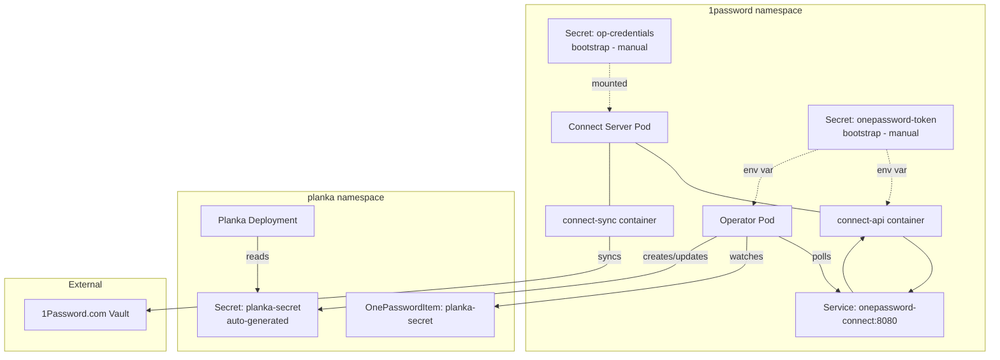

# Design Document: 1Password Secrets Integration

## Overview

This design integrates 1Password secret management into the k3s cluster using two components: the **1Password Connect Server** (a REST API for vault access) and the **1Password Kubernetes Operator** (a controller that syncs `OnePasswordItem` CRs into native Kubernetes Secrets).

The architecture follows the existing GitOps pattern: all manifests live in `workloads/1password/`, an ArgoCD Application in `argocd/apps/` manages deployment, and the single bootstrap secret (`1password-credentials.json` + access token) is applied manually via `kubectl` before the first sync.

The Planka workload serves as the first consumer — its plain-text `secret.yaml` is replaced with a `OnePasswordItem` CR that the operator resolves at runtime.

### Key Design Decisions

1. **Plain manifests over Helm** — Consistent with all other workloads in this cluster (gitea, planka, trust, etc.). No Helm controller is deployed.
2. **Connect mode over Service Account mode** — The operator connects to a local Connect Server rather than using a 1Password Service Account token directly. This keeps the token scoped to the Connect Server and allows multiple operators or CLI tools to share the same Connect instance.
3. **emptyDir for sync volume** — The Connect Server's encrypted data cache is ephemeral and rebuilt on startup from 1Password.com. No PVC needed.
4. **Manual bus configuration** — Kubernetes pods share localhost within a pod, but the connect-api and connect-sync containers need explicit bus peer configuration since they cannot use NET_BROADCAST in a restricted pod security context.

## Architecture



### Deployment Flow

1. Operator applies bootstrap secrets manually (`op-credentials`, `onepassword-token`)
2. ArgoCD syncs `workloads/1password/` → creates namespace, RBAC, Connect Server, Operator
3. Connect Server starts, authenticates with 1Password.com, syncs vault data
4. Operator starts, connects to Connect Server via `onepassword-connect.1password.svc.cluster.local:8080`
5. Operator watches `OnePasswordItem` resources cluster-wide
6. ArgoCD syncs `workloads/planka/` → deploys `OnePasswordItem` CR
7. Operator sees the CR, fetches item from Connect Server, creates `planka-secret` Secret
8. Planka deployment reads from `planka-secret` as before

## Components and Interfaces

### File Layout

```
workloads/1password/
├── namespace.yaml              # Namespace: 1password
├── connect-serviceaccount.yaml # ServiceAccount for Connect Server
├── operator-serviceaccount.yaml# ServiceAccount for Operator
├── clusterrole.yaml            # ClusterRole for Operator (onepassworditems + secrets)
├── clusterrolebinding.yaml     # ClusterRoleBinding for Operator
├── connect-deployment.yaml     # Deployment: connect-api + connect-sync
├── connect-service.yaml        # Service: onepassword-connect (ClusterIP, port 8080)
├── operator-deployment.yaml    # Deployment: onepassword-operator
└── README.md                   # Bootstrap instructions

argocd/apps/
└── 1password.yaml              # ArgoCD Application

workloads/planka/
├── onepassworditem.yaml        # OnePasswordItem CR (replaces secret.yaml)
└── (secret.yaml removed)
```

### Connect Server Deployment

| Field | Value |
|-------|-------|
| Name | `onepassword-connect` |
| Namespace | `1password` |
| Replicas | 1 |
| Container 1 | `connect-api` — image: `1password/connect-api:1.7.3` |
| Container 2 | `connect-sync` — image: `1password/connect-sync:1.7.3` |
| Shared Volume | `emptyDir` mounted at `/home/opuser/.op/data` |
| Credentials Mount | Secret `op-credentials` → `/home/opuser/.op/1password-credentials.json` |
| Token | Secret `onepassword-token` key `token` → env `OP_CONNECT_TOKEN` on connect-api |
| Ports | connect-api: 8080 (HTTP), bus: 11220; connect-sync: bus: 11221 |
| Security | `runAsUser: 999`, `runAsGroup: 999`, `runAsNonRoot: true` |
| Resources | connect-api: 50m/128Mi request; connect-sync: 50m/128Mi request |

### Connect Server Service

| Field | Value |
|-------|-------|
| Name | `onepassword-connect` |
| Namespace | `1password` |
| Type | ClusterIP |
| Port | 8080 → targetPort 8080 |
| Selector | `app: onepassword-connect` |

### Operator Deployment

| Field | Value |
|-------|-------|
| Name | `onepassword-operator` |
| Namespace | `1password` |
| Replicas | 1 |
| Image | `1password/onepassword-operator:1.8.0` |
| Env: `OP_CONNECT_HOST` | `http://onepassword-connect.1password.svc.cluster.local:8080` |
| Env: `POLLING_INTERVAL` | `600` (seconds) |
| Env: `WATCH_NAMESPACE` | (empty = all namespaces) |
| Env: `OP_CONNECT_TOKEN` | from Secret `onepassword-token` key `token` |
| Args | `--leader-elect`, `--zap-log-level=info` |
| Security | `runAsNonRoot: true` |
| Resources | 50m/128Mi request |

### RBAC

**ClusterRole: `onepassword-operator`**

| API Group | Resources | Verbs |
|-----------|-----------|-------|
| `onepassword.com` | `onepassworditems` | get, list, watch |
| `""` (core) | `secrets` | get, list, watch, create, update, delete |
| `""` (core) | `events` | create, patch |
| `apps` | `deployments` | get, list, watch, update, patch |

The `deployments` permission supports the AUTO_RESTART feature (rolling restart on secret update).

**ClusterRoleBinding: `onepassword-operator`**
- Binds ClusterRole `onepassword-operator` to ServiceAccount `onepassword-operator` in namespace `1password`

### ArgoCD Application

```yaml
apiVersion: argoproj.io/v1alpha1
kind: Application
metadata:
  name: 1password
  namespace: argocd
  finalizers:
    - resources-finalizer.argocd.argoproj.io
spec:
  project: default
  source:
    repoURL: http://gitea-http.gitea.svc.cluster.local:3000/infra/k8s.git
    targetRevision: main
    path: workloads/1password
  destination:
    server: https://kubernetes.default.svc
    namespace: 1password
  syncPolicy:
    automated:
      selfHeal: true
      prune: true
    syncOptions:
      - CreateNamespace=true
      - RespectIgnoreDifferences=true
  ignoreDifferences:
    - group: ""
      kind: Secret
      namespace: 1password
      name: op-credentials
      jsonPointers:
        - /data
    - group: ""
      kind: Secret
      namespace: 1password
      name: onepassword-token
      jsonPointers:
        - /data
```

The bootstrap secrets (`op-credentials` and `onepassword-token`) are not tracked in Git. To prevent ArgoCD from pruning them, they are annotated with `argocd.argoproj.io/compare-options: IgnoreExtraneous` when created manually. This tells ArgoCD to ignore resources that exist in the cluster but not in Git.

### OnePasswordItem CR (Planka)

```yaml
apiVersion: onepassword.com/v1
kind: OnePasswordItem
metadata:
  name: planka-secret
  namespace: planka
spec:
  itemPath: "vaults/Kubernetes/items/planka-secret"
```

The operator creates a Kubernetes Secret named `planka-secret` in the `planka` namespace with keys matching the 1Password item's fields (`POSTGRES_DB`, `POSTGRES_USER`, `POSTGRES_PASSWORD`, `SECRET_KEY`).

## Data Models

### Bootstrap Secrets (manually created, not in Git)

**Secret: `op-credentials`**
```yaml
apiVersion: v1
kind: Secret
metadata:
  name: op-credentials
  namespace: 1password
  annotations:
    argocd.argoproj.io/compare-options: IgnoreExtraneous
type: Opaque
data:
  1password-credentials.json: <base64-encoded credentials file>
```

**Secret: `onepassword-token`**
```yaml
apiVersion: v1
kind: Secret
metadata:
  name: onepassword-token
  namespace: 1password
  annotations:
    argocd.argoproj.io/compare-options: IgnoreExtraneous
type: Opaque
data:
  token: <base64-encoded connect token>
```

### Generated Secret (created by Operator)

The operator produces a standard `Opaque` Secret with fields sourced from the 1Password vault item:

```yaml
apiVersion: v1
kind: Secret
metadata:
  name: planka-secret
  namespace: planka
  annotations:
    operator.1password.io/item-path: "vaults/Kubernetes/items/planka-secret"
    operator.1password.io/item-name: "planka-secret"
type: Opaque
data:
  POSTGRES_DB: <base64>
  POSTGRES_USER: <base64>
  POSTGRES_PASSWORD: <base64>
  SECRET_KEY: <base64>
```

## Error Handling

| Scenario | Behavior |
|----------|----------|
| Bootstrap secrets missing at Connect Server start | Pod enters CrashLoopBackOff; pod events show mount failure |
| Connect Server unreachable by Operator | Operator retries with exponential backoff; emits Warning events on affected OnePasswordItems |
| 1Password vault item not found | Operator emits Warning event on OnePasswordItem; no Secret created |
| 1Password vault item field mismatch | Operator syncs whatever fields exist; missing keys result in empty values in the Secret |
| Connect Server loses connectivity to 1Password.com | Serves cached data from sync volume; logs errors; resumes sync when connectivity returns |
| ArgoCD prune on bootstrap secrets | Prevented by `IgnoreExtraneous` annotation on the secrets |
| Operator pod restart | Resumes watching from last resource version; re-syncs all OnePasswordItems on next poll |

## Testing Strategy

This feature is **Infrastructure as Code / declarative configuration** — it consists entirely of Kubernetes YAML manifests with no custom application logic. Property-based testing is not applicable.

### Validation Approach

1. **Static manifest validation** — `kubectl apply --dry-run=client` on all manifests to catch schema errors
2. **ArgoCD sync verification** — After deployment, verify the Application reaches `Synced` and `Healthy` status
3. **Integration tests** (manual checklist):
   - Connect Server pod reaches Running state with both containers ready
   - Operator pod reaches Running state
   - OnePasswordItem in planka namespace results in a `planka-secret` Secret being created
   - Planka deployment starts successfully using the operator-managed secret
   - Updating the 1Password vault item propagates to the Kubernetes Secret within 600s
4. **Bootstrap process test** — Verify that applying bootstrap secrets followed by ArgoCD sync produces a working system
5. **Prune safety test** — Verify that ArgoCD sync with prune enabled does not delete bootstrap secrets

### What is NOT tested with PBT

- Kubernetes manifest correctness (declarative, no logic)
- ArgoCD sync behavior (external controller)
- 1Password Connect Server behavior (third-party binary)
- Operator reconciliation logic (third-party binary)

All testing is integration/smoke-level, verifying that the manifests produce the expected cluster state.
