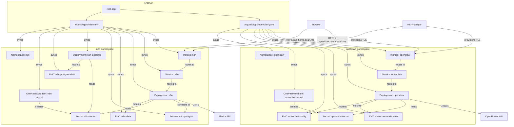

# Design Document: n8n & OpenClaw Deployment

## Overview

This design describes the Kubernetes manifests and ArgoCD configuration required to deploy n8n (workflow automation platform) and OpenClaw (personal AI assistant gateway) on the existing k3s cluster. Both deployments follow the established GitOps pattern: manifests live in `workloads/{app-name}/`, ArgoCD Applications in `argocd/apps/{app-name}.yaml` sync them, TLS is handled by cert-manager with the `step-ca-issuer` ClusterIssuer, and secrets are managed via 1Password Connect (OnePasswordItem CRDs).

The design mirrors the Planka workload structure — dedicated namespace, Deployment(s), Service, Ingress, PVC(s), and a OnePasswordItem for secret management.

**n8n** is a workflow automation tool requiring a PostgreSQL 16 database. It will be accessible at `n8n.home.bearl.me` and initially integrate with the existing Planka kanban board.

**OpenClaw** is a Node.js AI assistant gateway that connects to cloud AI providers via OpenRouter. It uses file-based storage (no database), runs as non-root UID 1000, and will be accessible at `openclaw.home.bearl.me`.

## Architecture



### Design Decisions

1. **Single-pod PostgreSQL for n8n** — n8n is a low-traffic internal tool. A single-replica PostgreSQL Deployment with a PVC is sufficient; no HA operator needed.
2. **Recreate strategy for all Deployments** — All PVCs use `ReadWriteOnce`, which cannot be mounted by two pods simultaneously. `Recreate` avoids stuck rollouts.
3. **Separate OnePasswordItem per workload** — Each workload gets its own OnePasswordItem CRD referencing a distinct 1Password vault item. This follows the established Planka pattern and keeps secrets scoped to their namespace.
4. **Two PVCs for OpenClaw** — A config PVC at `/home/node/.openclaw` (2Gi) and a workspace PVC at `/home/node/.openclaw/workspace` (5Gi). The workspace PVC is mounted as a subpath within the config mount path, keeping workspace data on a separate volume for independent sizing and backup.
5. **Non-root security context for OpenClaw** — OpenClaw runs as UID 1000 (node user). The pod security context sets `runAsUser: 1000`, `runAsGroup: 1000`, and `fsGroup: 1000` to ensure PVC files are writable.
6. **n8n PostgreSQL Service** — A dedicated ClusterIP Service for PostgreSQL allows n8n to connect via stable DNS (`n8n-postgres.n8n.svc.cluster.local:5432`).
7. **Proxy body size for n8n** — The n8n Ingress sets `proxy-body-size: 50m` to support large webhook payloads and file uploads.

## Components and Interfaces

### File Layout

```
argocd/apps/n8n.yaml                # ArgoCD Application for n8n
argocd/apps/openclaw.yaml           # ArgoCD Application for OpenClaw
workloads/n8n/
├── namespace.yaml                  # Namespace: n8n
├── onepassworditem.yaml            # OnePasswordItem → Secret: n8n-secret
├── postgres-pvc.yaml               # PVC: n8n-postgres-data (5Gi)
├── postgres-deployment.yaml        # Deployment: n8n-postgres
├── postgres-service.yaml           # Service: n8n-postgres (port 5432)
├── pvc.yaml                        # PVC: n8n-data (5Gi)
├── deployment.yaml                 # Deployment: n8n
├── service.yaml                    # Service: n8n (port 5678)
└── ingress.yaml                    # Ingress: n8n (TLS)
workloads/openclaw/
├── namespace.yaml                  # Namespace: openclaw
├── onepassworditem.yaml            # OnePasswordItem → Secret: openclaw-secret
├── config-pvc.yaml                 # PVC: openclaw-config (2Gi)
├── workspace-pvc.yaml              # PVC: openclaw-workspace (5Gi)
├── deployment.yaml                 # Deployment: openclaw
├── service.yaml                    # Service: openclaw (port 18789)
└── ingress.yaml                    # Ingress: openclaw (TLS)
```

### Component Details

#### n8n Workload

| Component | Resource | Name | Purpose |
|-----------|----------|------|---------|
| ArgoCD App | `Application` | `n8n` | Syncs `workloads/n8n` to the cluster |
| Namespace | `Namespace` | `n8n` | Resource isolation |
| OnePasswordItem | `OnePasswordItem` | `n8n-secret` | Syncs secrets from 1Password vault |
| PostgreSQL PVC | `PersistentVolumeClaim` | `n8n-postgres-data` | 5Gi RWO storage for DB |
| PostgreSQL | `Deployment` | `n8n-postgres` | PostgreSQL 16 single-replica |
| PostgreSQL Service | `Service` | `n8n-postgres` | ClusterIP on port 5432 |
| n8n PVC | `PersistentVolumeClaim` | `n8n-data` | 5Gi RWO storage for workflow files |
| n8n | `Deployment` | `n8n` | n8n application |
| Service | `Service` | `n8n` | ClusterIP on port 5678 |
| Ingress | `Ingress` | `n8n` | TLS termination, routes to Service |

#### OpenClaw Workload

| Component | Resource | Name | Purpose |
|-----------|----------|------|---------|
| ArgoCD App | `Application` | `openclaw` | Syncs `workloads/openclaw` to the cluster |
| Namespace | `Namespace` | `openclaw` | Resource isolation |
| OnePasswordItem | `OnePasswordItem` | `openclaw-secret` | Syncs secrets from 1Password vault |
| Config PVC | `PersistentVolumeClaim` | `openclaw-config` | 2Gi RWO storage for config/sessions |
| Workspace PVC | `PersistentVolumeClaim` | `openclaw-workspace` | 5Gi RWO storage for agent workspace |
| OpenClaw | `Deployment` | `openclaw` | OpenClaw gateway application |
| Service | `Service` | `openclaw` | ClusterIP on port 18789 |
| Ingress | `Ingress` | `openclaw` | TLS termination, routes to Service |

### Inter-Component Communication

- **n8n → PostgreSQL**: n8n connects via `n8n-postgres.n8n.svc.cluster.local:5432` using credentials from `n8n-secret`.
- **n8n → Planka**: n8n reaches Planka at `http://planka.planka.svc.cluster.local:1337` via cluster-internal DNS (no NetworkPolicy restrictions).
- **OpenClaw → OpenRouter**: OpenClaw makes outbound HTTPS requests to `https://openrouter.ai/api/` and downstream AI provider endpoints.
- **Ingress → Service → Pod**: External HTTPS traffic terminates TLS at the Ingress and forwards to the respective ClusterIP Service.
- **cert-manager → Ingress**: cert-manager reads the `cert-manager.io/cluster-issuer` annotation and provisions certificates stored in `{app}-tls` secrets.
- **1Password Connect → OnePasswordItem → Secret**: The 1Password operator watches OnePasswordItem CRDs and creates/updates the corresponding Kubernetes Secret.

## Data Models

### n8n Secret Structure (`n8n-secret`)

| Key | Description | Used By |
|-----|-------------|---------|
| `POSTGRES_DB` | Database name (e.g., `n8n`) | PostgreSQL, n8n |
| `POSTGRES_USER` | Database username | PostgreSQL, n8n |
| `POSTGRES_PASSWORD` | Database password | PostgreSQL, n8n |
| `N8N_ENCRYPTION_KEY` | Encryption key for stored credentials | n8n |

### OpenClaw Secret Structure (`openclaw-secret`)

| Key | Description | Used By |
|-----|-------------|---------|
| `OPENCLAW_GATEWAY_TOKEN` | Authentication token for gateway access | OpenClaw |
| `OPENROUTER_API_KEY` | API key for OpenRouter AI provider access | OpenClaw |

### Environment Variable Mapping

**n8n PostgreSQL Deployment:**

| Env Var | Source |
|---------|--------|
| `POSTGRES_DB` | `n8n-secret` key `POSTGRES_DB` |
| `POSTGRES_USER` | `n8n-secret` key `POSTGRES_USER` |
| `POSTGRES_PASSWORD` | `n8n-secret` key `POSTGRES_PASSWORD` |

**n8n Deployment:**

| Env Var | Source |
|---------|--------|
| `DB_TYPE` | Literal `postgresdb` |
| `DB_POSTGRESDB_HOST` | Literal `n8n-postgres` |
| `DB_POSTGRESDB_PORT` | Literal `5432` |
| `DB_POSTGRESDB_DATABASE` | `n8n-secret` key `POSTGRES_DB` |
| `DB_POSTGRESDB_USER` | `n8n-secret` key `POSTGRES_USER` |
| `DB_POSTGRESDB_PASSWORD` | `n8n-secret` key `POSTGRES_PASSWORD` |
| `N8N_ENCRYPTION_KEY` | `n8n-secret` key `N8N_ENCRYPTION_KEY` |
| `WEBHOOK_URL` | Literal `https://n8n.home.bearl.me/` |
| `N8N_EDITOR_BASE_URL` | Literal `https://n8n.home.bearl.me/` |
| `N8N_COMMUNITY_PACKAGES_ENABLED` | Literal `true` |
| `GENERIC_TIMEZONE` | Literal `America/Chicago` |

**OpenClaw Deployment:**

| Env Var | Source |
|---------|--------|
| `OPENCLAW_GATEWAY_TOKEN` | `openclaw-secret` key `OPENCLAW_GATEWAY_TOKEN` |
| `OPENROUTER_API_KEY` | `openclaw-secret` key `OPENROUTER_API_KEY` |
| `OPENCLAW_GATEWAY_BIND` | Literal `lan` |
| `OPENCLAW_GATEWAY_PORT` | Literal `18789` |
| `NODE_ENV` | Literal `production` |

### Persistent Volume Claims

| PVC Name | Namespace | Capacity | Access Mode | Mount Path | Pod |
|----------|-----------|----------|-------------|------------|-----|
| `n8n-postgres-data` | `n8n` | 5Gi | ReadWriteOnce | `/var/lib/postgresql/data` | n8n-postgres |
| `n8n-data` | `n8n` | 5Gi | ReadWriteOnce | `/home/node/.n8n` | n8n |
| `openclaw-config` | `openclaw` | 2Gi | ReadWriteOnce | `/home/node/.openclaw` | openclaw |
| `openclaw-workspace` | `openclaw` | 5Gi | ReadWriteOnce | `/home/node/.openclaw/workspace` | openclaw |

### ArgoCD Application Specs

Both ArgoCD Applications follow the same pattern:

| Field | n8n | OpenClaw |
|-------|-----|----------|
| `metadata.name` | `n8n` | `openclaw` |
| `metadata.namespace` | `argocd` | `argocd` |
| `spec.source.repoURL` | `http://gitea-http.gitea.svc.cluster.local:3000/infra/k8s.git` | same |
| `spec.source.targetRevision` | `main` | `main` |
| `spec.source.path` | `workloads/n8n` | `workloads/openclaw` |
| `spec.destination.server` | `https://kubernetes.default.svc` | same |
| `spec.destination.namespace` | `n8n` | `openclaw` |
| `syncPolicy.automated` | `selfHeal: true, prune: true` | same |
| `syncOptions` | `CreateNamespace=true` | same |
| `finalizers` | `resources-finalizer.argocd.argoproj.io` | same |

## Error Handling

### Missing or Incomplete Secret (1Password Sync Failure)

If the 1Password Connect operator cannot sync the OnePasswordItem (vault item missing, operator down, or network issue), the corresponding Kubernetes Secret will not exist. Pods referencing `secretKeyRef` will fail to schedule with `CreateContainerConfigError`. The operator should check 1Password Connect pod health and vault item existence.

### PVC Not Bound

If the default StorageClass (local-path on k3s) cannot provision a volume, the PVC remains in `Pending` state and the pod cannot start. The operator should verify available disk space and StorageClass health.

### PostgreSQL Unavailable (n8n)

If PostgreSQL is not ready when n8n starts, n8n will crash-loop. Kubernetes' restart policy (`Always`) will retry with exponential backoff. Once PostgreSQL is healthy, n8n will connect on the next restart. This is acceptable for a low-traffic internal tool.

### OpenRouter API Unreachable (OpenClaw)

If OpenRouter or downstream AI providers are unreachable, OpenClaw will return an error to the connected messaging channel indicating the provider is unavailable. The gateway itself remains running and will retry on subsequent requests.

### ArgoCD Sync Failures

If manifests contain invalid YAML or reference non-existent resources, ArgoCD will report a sync failure in its UI/CLI. The operator resolves this by fixing the manifests in Git and allowing ArgoCD to re-sync.

### PVC Permission Issues (OpenClaw)

If the PVC filesystem does not allow writes by UID 1000, OpenClaw will fail to start. The `fsGroup: 1000` security context ensures the kubelet sets group ownership on mount. If using a StorageClass that doesn't support fsGroup (unlikely with local-path), an init container with `chown` may be needed.

## Testing Strategy

### Why Property-Based Testing Does Not Apply

This feature consists entirely of declarative Kubernetes YAML manifests and ArgoCD Application resources. There is no application code, no pure functions, and no input/output transformations to test. Property-based testing is explicitly not appropriate for Infrastructure as Code.

### Recommended Testing Approach

1. **Schema Validation (CI)**
   - Use `kubeconform` or `kubeval` to validate all YAML manifests against Kubernetes OpenAPI schemas.
   - Validates that resource kinds, API versions, and field types are correct.
   - Run against both `workloads/n8n/` and `workloads/openclaw/` directories.

2. **Linting (CI)**
   - Use `kube-linter` to check for best-practice violations (missing resource requests, missing labels, security context issues).

3. **Dry-Run Sync (Pre-merge)**
   - Use `argocd app diff` or `argocd app sync --dry-run` to verify the manifests apply cleanly before merging.

4. **Integration Tests (Post-Deploy)**
   - Verify both ArgoCD Applications reach `Synced` and `Healthy` status.
   - Verify n8n pod reaches `Running` state and passes readiness checks.
   - Verify OpenClaw pod reaches `Running` state.
   - Verify HTTPS connectivity to `https://n8n.home.bearl.me` returns a 200 response.
   - Verify HTTPS connectivity to `https://openclaw.home.bearl.me` returns a response on the gateway port.
   - Verify n8n can connect to its PostgreSQL instance (check n8n logs for successful DB connection).
   - Verify 1Password-synced secrets exist in both namespaces.

5. **Manual Smoke Tests**
   - **n8n**: Log in to the n8n editor, create a simple workflow, execute it, and verify execution history persists across pod restart.
   - **OpenClaw**: Send a test message through the gateway and verify a response is returned from OpenRouter.
   - **n8n → Planka**: Create a workflow that calls the Planka API and verify it succeeds.
